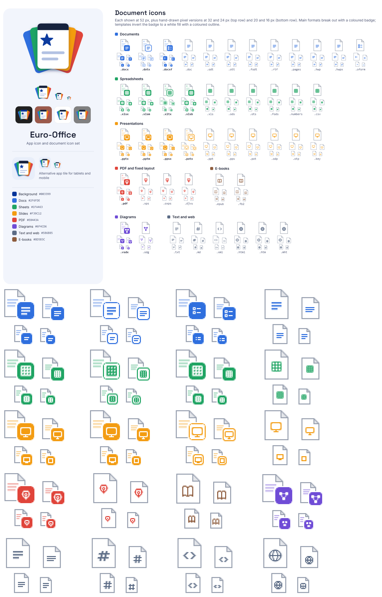

# Euro-Office icons

A replacement icon set for [Euro-Office](https://github.com/Euro-Office/DesktopEditors) - I couldn't live with the default icon, which is barebones at best.

Thanks Claude!

There's a script to install these icons on top of Euro-Office. Currently tested on Windows only, but Claude's done its best attempt at getting something workable for Mac and Linux. Contributions happily accepted.



## Quick start

Python 3.8 or newer, standard library only — nothing to install first.

```
python tools/set-icons.py --list       # what is on this machine
python tools/set-icons.py --dry-run    # what would change
python tools/set-icons.py              # do it
python tools/set-icons.py --uninstall  # put it all back
```

Every change is written to an append-only journal before it is made, so an interrupted run is
still undoable, and a second run does not forget what the system looked like before the first.

[`tools/README.md`](tools/README.md) has the detail: how Windows resolves an icon, why fewer
types change than there are icons, what needs an elevated prompt and what it cannot touch.

## Status

| | Artwork | Installer |
|---|---|---|
| Windows | complete | **implemented and tested** |
| Linux (freedesktop) | complete | written, **not yet run on a real desktop** |
| macOS | complete | detection only — [contributions welcome](#adding-a-platform) |
| Web, iOS, Android, MSIX | complete | n/a — drop the files in by hand |

## What is in the box

```
icons/
  source/      SVG masters, palette.json, filetypes.json (extension -> group, MIME, primary/template)
  windows/     .ico files (app + one per extension) and MSIX/Store PNGs
  macos/       AppIcon.iconset + AppIcon.icns, one .icns per extension
  linux/       freedesktop hicolor theme tree (apps + mimetypes, PNG sizes + scalable SVG)
  web/         favicon.svg/.ico, apple-touch-icon, PWA icons + manifest.webmanifest
  mobile/      iOS marketing icon, Android adaptive + legacy launcher icons, tablet tiles
tools/
  set-icons.py the installer
  eoicons/     catalog, undo journal, one module per platform
```

Everything is generated from the SVG masters in `icons/source/`. If a design changes, re-export
from those rather than editing the bitmaps. [`icons/README.md`](icons/README.md) documents the
artwork, the size rules and the per-platform install recipes by hand.

## What it does not change

`DesktopEditors.exe`'s own icon — the one Explorer draws on the executable, and the one the
running window and its taskbar button use — is a resource inside the signed binary, so the
script leaves it alone. Re-pointing the Start Menu shortcuts covers most of what you actually
look at.

On Windows, a file type whose association is stale, or which another application owns, keeps
drawing its current icon. `--list` sorts every extension into *will change*, *drawn by another
application* and *no application supplies an icon*, and says what to do about the last two.

## Adding a platform

A platform module is one class with three methods — `detect`, `plan`, `undo` — described in
[`tools/eoicons/platforms/base.py`](tools/eoicons/platforms/base.py). Nothing else needs to
know your platform exists, and you can build and inspect another platform's plan from any
machine:

```
python tools/set-icons.py --platform linux --list
python tools/set-icons.py --platform linux --force --dry-run
```

**Linux** is written but unverified: run it, and flip `tested = True` if it behaves.
**macOS** needs the real work — `plan()` raises, and the module docstring lays out the
remaining steps and the code-signing hazard to watch for.

## Licence

[MIT](LICENSE), for the artwork and the script alike.

Euro-Office itself is AGPL-3.0. MIT is deliberately more permissive than that, so this set can
be taken upstream and shipped as part of Euro-Office — or any of its downstreams — with no
licence friction in either direction. If that ever happens, consider this an open invitation.

"Euro-Office" and the ONLYOFFICE name and logo belong to their respective owners; this is an
unofficial, unaffiliated set.
